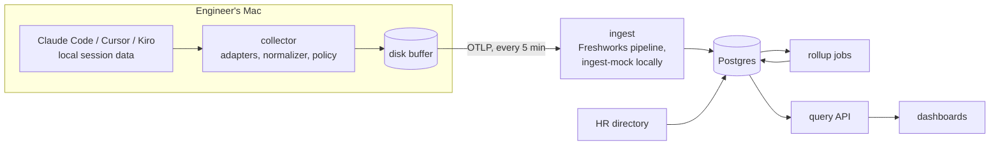

# fwcoach

Fleet telemetry for AI coding assistants. A collector on each engineer's Mac
reads what Claude Code, Cursor and Kiro record locally. It applies a content
policy and uploads usage in the Freshworks v2 payload format. A backend stores
it in Postgres, rolls it up by team and manager, and serves it to dashboards
through a query API that knows who is allowed to see whom.

Built by Generative AI at Berkeley for Freshworks, Fall 2026.



## Layout

| Path                   | What                                                    | Owner            |
| ---------------------- | ------------------------------------------------------- | ---------------- |
| `packages/contracts`   | v2 payload as Zod schemas, OTLP encoding, fixtures      | AG-2, AG-3, AG-4 |
| `packages/collector`   | The local agent: adapters, policy, buffer, uploader     | Agent team       |
| `packages/testkit`     | Synthetic org trees and synthetic traffic               | BE-2, AG-1       |
| `services/ingest-mock` | Stand-in for the Freshworks pipeline                    | BE-1             |
| `services/api`         | Query API, rollup jobs, directory sync, pricing         | Backend team     |
| `db/migrations`        | Postgres schema as dbmate migrations                    | Backend team     |
| `apps/dashboard`       | The four dashboard views, on Dew                        | X-3              |
| `e2e`                  | Acceptance criteria as tests, against the compose stack | Every ticket     |
| `docs`                 | Architecture, decisions, contracts, formats, runbooks   | Everyone         |

## Quick start

Needs Node 24 (22 works), pnpm 10 (`corepack enable`), Docker, and Python 3
for the content lint.

```sh
pnpm install
cp .env.example .env       # dev scripts and dbmate read it
docker compose up -d postgres
pnpm db:up                 # migrations, as the owner
pnpm test                  # unit tests
pnpm dev:ingest            # mock ingest on :4318
pnpm dev:api               # API on :8080
pnpm dev:dashboard         # dashboard on :3000, mock data until API_BASE_URL is set
pnpm --filter @fwcoach/collector dry-run    # what the collector would send
```

`docker compose up -d postgres` (not `pnpm dev:infra` on an old volume)
matters the first time: the volume's init script creates the `fwcoach_api`
service user.

Or the whole stack in containers: `docker compose up -d --build --wait`. If a
port is taken, set `POSTGRES_PORT`, `INGEST_PORT` or `API_PORT`.

Full walkthrough: [docs/runbooks/local-dev.md](docs/runbooks/local-dev.md).

## Before you open a PR

Read [CONTRIBUTING.md](CONTRIBUTING.md) and [AGENTS.md](AGENTS.md). Run
`pnpm check`. PR titles start with the ticket ID, like `BE-2: dedupe on msg_id`.

## Where to read next

- [docs/architecture.md](docs/architecture.md): how the pieces fit and why
- [docs/tickets.md](docs/tickets.md): every ticket, where its code goes, what it waits on
- [docs/decisions](docs/decisions): decisions already made. Do not relitigate them in a PR; propose a new ADR instead.
- [docs/contracts/ingest.md](docs/contracts/ingest.md): the wire format and auth flow

## Data rules

The repo is public. No real names, no internal URLs, no real session content,
no credentials, ever. Fixtures and demo data are synthetic. Internal
configuration arrives at runtime. See [SECURITY.md](SECURITY.md).
