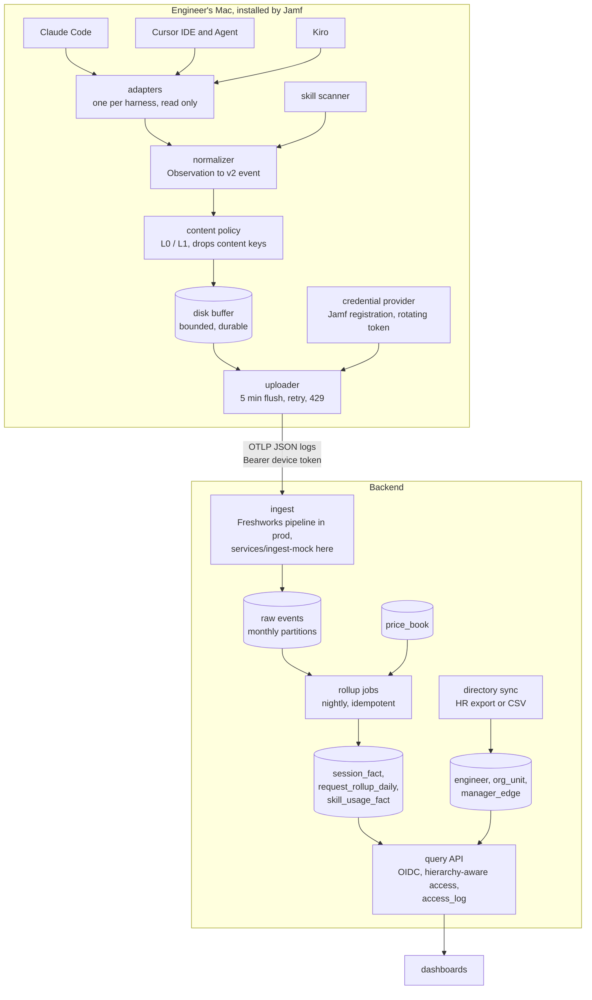

# Architecture

## What we are building

The sponsor spec (Fall 2026 Internship Project Specification, section 7)
asks for a fleet view of AI coding assistant use at Freshworks: who uses which
harness, at what cost, which skills are catching on, with drill-down along the
management chain. This repo is the Phase 2 system: collector, ingestion,
storage, rollups, query API and dashboards.

## Components

### Collector (`packages/collector`)

A Node daemon started by launchd. Each pass asks every adapter for new
observations since its last cursor. The normalizer builds a v2 event from
each, the policy check drops anything carrying content, and the survivors go
into a durable, size-bounded buffer. Every five minutes the uploader drains
the buffer in batches with the current device credential.

The collector does not sign anyone in. It reuses the existing Freshworks
device flow: a registration credential pushed by Jamf, exchanged on first run
for a rotating device credential that identifies engineer and device
([ADR 0002](decisions/0002-ingest-through-freshworks-pipeline.md)).

Design rules that drive the code:

- **Idempotent end to end.** Event IDs are UUIDv5 over stable source facts
  (`contracts/src/ids.ts`). Re-reading a session or retrying a batch yields
  the same IDs, and the receiver drops duplicates on `msg_id`. The buffer
  acks only after the server accepts, so a crash resends rather than loses.
- **Local policy enforcement.** The server can ask for less, never more
  (spec 7.3). L2 (prompt text) is not implemented.
- **One broken harness does not stop the others.** Adapter errors are logged
  and skipped per pass.
- **Read only on harness data.** Adapters never write to or lock what they read.

### Contracts (`packages/contracts`)

The one place the event shape is defined. The collector builds events with
it, ingest-mock validates them with it, and the e2e suite uses its fixtures.
If the shape changes, it changes here first, with both teams reviewing.

### Ingest

In production this is the Freshworks telemetry pipeline, which we do not run
or change. Here it is `services/ingest-mock`, which accepts the same OTLP
payload, auth header and limits, and writes raw events to Postgres so the
rest of the backend has real input. New fields go to Freshworks as a proposal
([contracts/proposed-fields.md](contracts/proposed-fields.md)).

### Storage, rollups, API (`db`, `services/api`)

Self-hosted Postgres 18. Raw events are partitioned by month on
`occurred_at`, so retention is a partition drop
([ADR 0006](decisions/0006-retention.md)). Nightly jobs rebuild a day's
rollups in one transaction. The directory sync writes `manager_edge` with
effective dates, so a reorg adds rows instead of rewriting history.

The query API serves the read paths from spec 7.5. Access to an individual is
allowed to the engineer, their management chain as of the date viewed, and
platform admins. It is checked in the route and again by row-level security,
and every allowed individual view is written to `access_log`.

## Decisions that shape the code

| ADR                                                          | Decision                                                                 |
| ------------------------------------------------------------ | ------------------------------------------------------------------------ |
| [0001](decisions/0001-typescript-monorepo.md)                | TypeScript monorepo, pnpm workspaces, Zod contracts shared by both sides |
| [0002](decisions/0002-ingest-through-freshworks-pipeline.md) | Ingest in the Freshworks v2 format through their pipeline; we mock it    |
| [0003](decisions/0003-subagents-roll-into-parent.md)         | Subagent work rolls into the parent session and is marked                |
| [0004](decisions/0004-rebuild-not-salvage.md)                | Rebuild, using earlier PRs only as reference                             |
| [0005](decisions/0005-credits-and-cost.md)                   | Credits stay credits; cost is sourced or null                            |
| [0006](decisions/0006-retention.md)                          | 13 months of detail, summaries kept                                      |
| [0007](decisions/0007-public-repo-hygiene.md)                | Public repo: internal anything arrives as config                         |

## Not in this repo yet

- **The VS Code extension work** (Phase 1 of the spec, in the upstream fork).
  If its core parsing library exists, adapters should call it instead of
  re-implementing the same parsing here.
