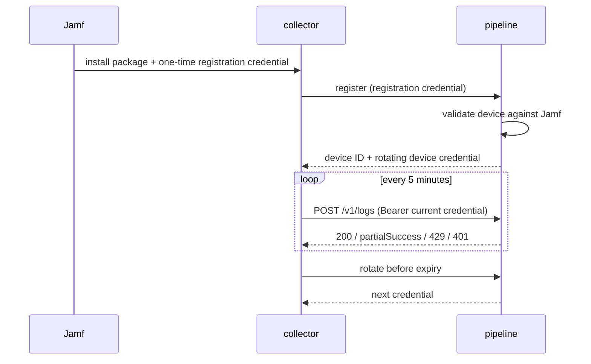

# Ingest contract

How events get from the collector to the backend. The schema in code is
`packages/contracts`. This doc covers what code cannot: the flow, the limits,
and what is still unknown.

Source: the v2 payload format Freshworks asked us to build against (still in
development on their side) and their answers in the project thread. When
either changes, update this doc and the contracts package in the same PR.

## Wire format

```
POST {ingestUrl}/v1/logs
Authorization: Bearer <device credential>
Content-Type: application/json

OTLP JSON logs request
  resourceLogs[].scopeLogs[].logRecords[]
    body.bytesValue = base64( DeliveryMessage )

DeliveryMessage
  account_id       "ai-telemetry-internal"
  service          "ai-builder-telemetry"
  payload_type     "ai_builder_event"
  payload_version  2
  msg_id           = payload.event_id   (de-duplication key)
  payload          one v2 event
```

Every v2 event has the same outer blocks (`source`, `device`, `session`,
`model`, `repo`, `pdlc`, `data`, `ext`). Only `event_type` and `data` change
between types. A missing key means not measured. `0` means measured as zero.
No prompts, file paths or file contents are ever sent.

## Device identity

The collector reuses the Freshworks flow and never signs anyone in:



The mock's `/v1/devices/register` and `/v1/devices/credential` paths are our
invention. The real pipeline's paths are configuration.

## Behaviour both sides implement

| Situation                 | Receiver                                 | Collector                                          |
| ------------------------- | ---------------------------------------- | -------------------------------------------------- |
| Same `msg_id` twice       | Store once, answer 200                   | Retries reuse IDs, so this is the normal case      |
| Some records invalid      | 200 with `partialSuccess`, keep the rest | Ack all, log rejected IDs, never resend them as-is |
| Event over the size limit | Reject the record                        | Replace it with `event_rejected` before sending    |
| Too many requests         | 429 with `Retry-After`                   | Keep the batch, wait at least that long, jitter    |
| 5xx or network error      | n/a                                      | Keep the batch, exponential backoff with jitter    |
| 401                       | n/a                                      | Refresh the credential once, then stop and report  |
| Buffer full on the device | n/a                                      | Evict oldest, count evictions in daemon_heartbeat  |

## Open questions for Freshworks

1. **Credential lifetime.** Described as rotating daily, but the
   `daemon_heartbeat` example implies a longer lifetime. The collector
   reads expiry from the credential and assumes neither.
2. **OTLP envelope.** The doc fixes `body.bytesValue`. We set
   `service.name` and `service.version` resource attributes and one scope.
   Confirm the pipeline ignores or accepts them.
3. **Limits.** Maximum request size, maximum records per request, rate and
   burst limits, and the `Retry-After` format. The mock uses placeholders.
4. **New harness values.** Whether `source.ide` will accept `kiro` and
   `cursor-agent` (see proposed-fields.md).
5. **Claude Code token usage.** The doc lists `token_usage` as Cursor only.
   We plan to read Claude Code usage from local transcripts. Confirm that
   sending it as `token_usage` is acceptable.
