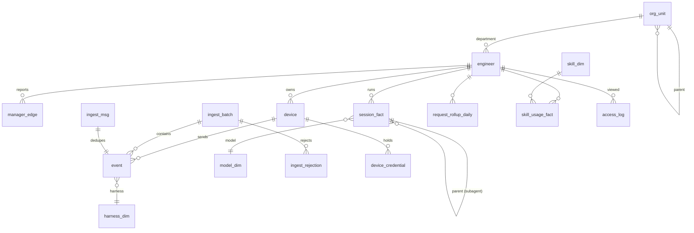

# Data model

Target schema. Each backend ticket writes the migrations for its own tables
and keeps its section of this doc in step: BE-1 ingestion, BE-2 identity,
org and audit, BE-3 facts and rollups, BE-4 price book and model aliases.
Starting point is spec 7.4, plus what the tickets and the Freshworks answers
added. The GitHub issues hold the full design for each table. Everything lives in the `app` schema.

## Identity and org

| Table          | Key columns                                                                                                                                        | Notes                                                                                                                                                                                           |
| -------------- | -------------------------------------------------------------------------------------------------------------------------------------------------- | ----------------------------------------------------------------------------------------------------------------------------------------------------------------------------------------------- |
| `engineer`     | `employee_id` PK, `sso_subject`, `work_email`, `display_name`, `department_id`, `l2_consent_until`, `agent_version`, `last_seen_at`, `departed_at` | `sso_subject` maps OIDC `sub`. A directory export may lack it or a department ID. If so, `work_email` is the join key and a cost-center-like grouping stands in for department until confirmed. |
| `org_unit`     | `id` PK, `parent_id`, `name`, `type`                                                                                                               | Department tree.                                                                                                                                                                                |
| `manager_edge` | `engineer_id`, `manager_id`, `valid_from`, `valid_to` (null = current)                                                                             | Effective-dated. A reorg closes rows and opens new ones, never updates history. Exclusion constraint: no overlapping ranges per engineer. Leader rollups use a recursive CTE as of a date.      |
| `device`       | `device_id` PK, `engineer_id`, `first_seen_at`, `last_seen_at`                                                                                     | Filled from the credential mapping.                                                                                                                                                             |

## Ingestion

| Table               | Key columns                                                                                                                                          | Notes                                                                                                                                                                                                                                                                                                                                        |
| ------------------- | ---------------------------------------------------------------------------------------------------------------------------------------------------- | -------------------------------------------------------------------------------------------------------------------------------------------------------------------------------------------------------------------------------------------------------------------------------------------------------------------------------------------- |
| `ingest_msg`        | `msg_id` PK, `received_at`                                                                                                                           | The de-duplication key. Unpartitioned on purpose: Postgres requires the partition key in every unique index on a partitioned table, so `event` alone could only be unique on `(msg_id, occurred_at)`. That breaks if a collector fix re-sends the same `msg_id` with a corrected timestamp. Pruned with the event partitions, plus a margin. |
| `event`             | `msg_id`, `occurred_at`, `device_id`, `engineer_id`, `harness`, `event_type`, `session_id`, `payload jsonb`, `batch_id`                              | Raw v2 events. Partitioned by month on `occurred_at`. A row is inserted only after its `msg_id` is claimed in `ingest_msg`. Kept 13 months.                                                                                                                                                                                                  |
| `ingest_batch`      | `id` PK, `device_id`, `agent_version`, `received_at`, `accepted`, `duplicates`, `rejected`, `status`                                                 | One row per upload, for fleet health.                                                                                                                                                                                                                                                                                                        |
| `ingest_rejection`  | `id` PK, `batch_id`, `device_id`, `msg_id` (when decodable), `reason` (`invalid_schema`, `not_base64`, `too_large`), `payload_sha256`, `received_at` | Every record not stored, with why. Never the payload itself. Fleet health (BE-4) reads it.                                                                                                                                                                                                                                                   |
| `device_credential` | `device_id`, `credential_sha256`, `issued_at`, `expires_at`, `revoked_at`                                                                            | Hashes only. Two rows overlap briefly during rotation so a sleeping laptop is not locked out.                                                                                                                                                                                                                                                |
| `retention_run`     | `id` PK, `ran_at`, `dry_run`, `partitions_dropped`, `rows_purged`                                                                                    | One row per retention job run, so deletion is auditable.                                                                                                                                                                                                                                                                                     |

## Facts and rollups (built by BE-3 jobs)

| Table                  | Grain                            | Notes                                                                                                                                                                                                    |
| ---------------------- | -------------------------------- | -------------------------------------------------------------------------------------------------------------------------------------------------------------------------------------------------------- |
| `session_fact`         | one session                      | engineer, harness, repo name, start, end, request count, token totals, credit totals, `cost_usd` (nullable), `cost_source`, end reason, `parent_session_id`, `is_subagent`, `is_orphan`. Kept 13 months. |
| `request_rollup_daily` | engineer x day x harness x model | Counts, tokens by class, credits, cost and cost coverage, subagent share broken out. Kept indefinitely.                                                                                                  |
| `skill_usage_fact`     | engineer x skill x day           | Invocation count, `installed` flag so adoption is distinct from availability. Kept indefinitely.                                                                                                         |
| `antipattern_finding`  | engineer x rule x day            | Severity and count.                                                                                                                                                                                      |
| `rollup_dirty_day`     | day                              | Days that need rebuilding: late events (BE-1 marks them) or a price change (BE-4). The nightly job drains it first.                                                                                      |

## Dimensions and reference data

| Table         | Notes                                                                                                                                                          |
| ------------- | -------------------------------------------------------------------------------------------------------------------------------------------------------------- |
| `harness_dim` | claude-code, cursor, cursor-agent, kiro.                                                                                                                       |
| `model_dim`   | Model IDs as reported, plus a normalised family.                                                                                                               |
| `skill_dim`   | De-duplicated by content hash plus ID. Carries the InstalledSkill fields.                                                                                      |
| `model_alias` | Maps reported model IDs to a `price_book` key. Explicit only: an unknown ID stays unpriced, never fuzzy-matched.                                               |
| `price_book`  | `kind` (token, credit, gpu), `key` (model, provider or deployment), `token_class`, `unit_price_usd`, `source`, `effective_from`, `effective_to`. See ADR 0005. |

## Audit

| Table        | Notes                                                                                                                                                                                                              |
| ------------ | ------------------------------------------------------------------------------------------------------------------------------------------------------------------------------------------------------------------ |
| `access_log` | `viewer_id`, `subject_id`, `route`, `viewed_at`. Written in the same transaction as every individual-detail read. Readable by platform admins only. Not subject to the 13-month purge without a separate decision. |

## Access control in the database

Row-level security on every table with per-engineer rows. The API sets
`app.engineer_id` per transaction with `set local`. Policies allow a row when
it belongs to the caller, to someone in the caller's subtree as of the row's
date, or when the caller is a platform admin. The API role does not own the
tables, so RLS applies to it.

The rule lives in one SQL function, `app.reports_to(viewer, subject, as_of)`,
used by both the RLS policies and `AccessPolicy`. Tables opt in through a
helper, `app.protect(table, engineer_column, date_column)`, which enables and
forces RLS and attaches the standard policy. BE-2 ships both first. Every
other ticket calls `app.protect()` on its per-engineer tables instead of
writing its own policy.

Rollup rows that carry cost also carry `cost_coverage` and `cost_price_ids`,
the `price_book` rows used, so any total can be explained (`?explain=true`).
