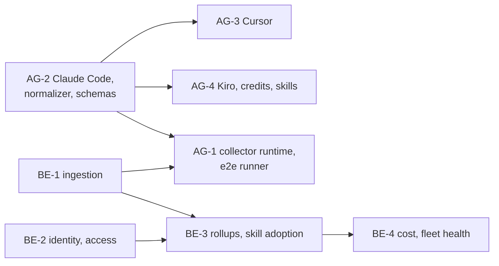

# Tickets

Eight tickets, four per team. Each one is a vertical slice: the person who
takes it owns the design, the code, the unit tests, and the end-to-end checks
tagged with its ID in `e2e/pipeline.e2e.test.ts`. Nobody owns "just the
tests" or "just the schema". Every backend ticket writes the migrations for
its own tables.

The full ticket text, checklist and status live in the GitHub issues. This
page is the map from ticket to code.

Find a ticket's stubs with `grep -rn "TODO(BE-2)" .` (or your ticket ID).

## Milestones

| Date       | Every ticket has...                                               |
| ---------- | ----------------------------------------------------------------- |
| Mon Nov 30 | Its first PR merged: migrations, event schemas, or the format doc |
| Fri Dec 4  | Its component working against the mocks                           |
| Wed Dec 9  | Its end-to-end checks passing in CI                               |
| Fri Dec 11 | Demo                                                              |

## Order

Everyone can start on day one. The arrows are where one ticket consumes
another's output, so agree the interface early, not wait for the code.

## Backend & Data

### BE-1 Ingestion pipeline ([#6](https://github.com/Generative-AI-at-Berkeley/fwcoach/issues/6))

Raw events from the wire into Postgres: event partitions, `ingest_msg`
dedupe, devices, batches, rate and burst limits, oversized events, the mock
device registration and credential rotation, and the retention job.

- Code: `services/ingest-mock`, `db/migrations`, `services/api/src/jobs/retention.ts`
- Done: replaying the same batch twice stores it once, and the limits are covered by tests.

### BE-2 Identity, org and access ([#7](https://github.com/Generative-AI-at-Berkeley/fwcoach/issues/7))

Who people are and who can see whom: engineer, org_unit, effective-dated
manager_edge, the roster CSV loader, the synthetic org generator with a reorg,
OIDC and local auth, row-level security, AccessPolicy, access_log, and the
`/v1/me`, `/v1/engineers` and `/v1/admin/access-log` routes.

- Code: `services/api/src/{auth,access,directory}`, `src/routes/v1.ts`, `packages/testkit/src/org.ts`
- Done: a manager cannot see anyone outside their subtree, including after a reorg in the test data.

### BE-3 Rollups and skill adoption ([#8](https://github.com/Generative-AI-at-Berkeley/fwcoach/issues/8))

Turning raw events into answers: session_fact, request_rollup_daily,
skill_usage_fact, the idempotent nightly job with subagent work inside the
parent and broken out, and the `/v1/org`, `/v1/leaders` and
`/v1/skills/adoption` routes. Skill adoption is the sponsor's headline view.

- Code: `services/api/src/jobs/rollup-daily.ts`, `src/routes/v1.ts`
- Done: rollups match the raw events, and re-running a day gives the same answer.

### BE-4 Cost model and fleet health ([#9](https://github.com/Generative-AI-at-Berkeley/fwcoach/issues/9))

What it all costs and whether the fleet is healthy: price_book with a sourced
default seed, the PriceBook for tokens, credits and self-hosted GPU time,
recompute on price change, cost coverage on every cost total, and
`/v1/fleet/health`.

- Code: `services/api/src/pricing`, `db/seeds`, `src/routes/v1.ts`
- Done: changing a price recomputes cost without touching the raw events.

## Agent & Integration

### AG-1 Collector runtime and privacy ([#10](https://github.com/Generative-AI-at-Berkeley/fwcoach/issues/10))

The daemon itself: DiskBuffer, HttpUploader, the Jamf credential flow,
cursors, daemon_heartbeat and event_rejected, the content policy as a
per-event allowlist, `--dry-run`, Jamf packaging, and the end-to-end runner
with its synthetic day of traffic.

- Code: `packages/collector/src/{buffer,upload,auth,policy}`, `src/daemon.ts`, `packages/testkit/src/traffic.ts`, `e2e/`
- Done: it survives kill -9 mid-flush and the mock ingest shows no duplicates.

### AG-2 Claude Code, normalizer and event schemas ([#11](https://github.com/Generative-AI-at-Berkeley/fwcoach/issues/11))

The first harness and the shared contract: the Claude Code format doc and
adapter (token usage from transcripts, subagent links, skill invocations),
the normalizer every adapter uses, and the Zod schemas and fixtures for the
session, tool, command and agent event types.

- Code: `packages/collector/src/adapters/claude-code`, `src/normalize`, `packages/contracts`, `docs/formats/claude-code.md`
- Done: one real Claude Code session produces valid events that match the fixtures.

### AG-3 Cursor IDE and Cursor Agent ([#12](https://github.com/Generative-AI-at-Berkeley/fwcoach/issues/12))

The hardest format: the Cursor format doc, SQLite read-only with no
`sqlite3` binary, the `agentKv` join for edited files, version detection,
gigabyte databases read incrementally, the agent transcripts, orphan
subagents, and the Cursor event schemas (`token_usage`, `pdlc_*`).

- Code: `packages/collector/src/adapters/cursor` plus a Cursor Agent adapter, `packages/contracts`, `docs/formats/cursor.md`
- Done: sessions from both surfaces arrive as separate harnesses with tokens where Cursor records them.

### AG-4 Kiro, credits and skills ([#13](https://github.com/Generative-AI-at-Berkeley/fwcoach/issues/13))

The newest harness and everything about skills: the Kiro format doc (due
Tue Dec 1) and adapter with credits and sub-executions, the SkillScanner
across all harnesses (Claude skills, Cursor rules, Kiro steering and Powers),
the CatalogProvider with a mock marketplace, and the field proposal to
Freshworks.

- Code: `packages/collector/src/adapters/kiro`, `src/skills`, `packages/contracts/src/proposed.ts`, `docs/formats/kiro.md`, `docs/contracts/proposed-fields.md`
- Done: a Kiro session lands with credits and the parent and subagent link, and installed skills show up with invocation counts.

## Not ticketed yet

- Dashboards (spec 7.6). They can start once BE-2 and BE-3 have routes returning data.
