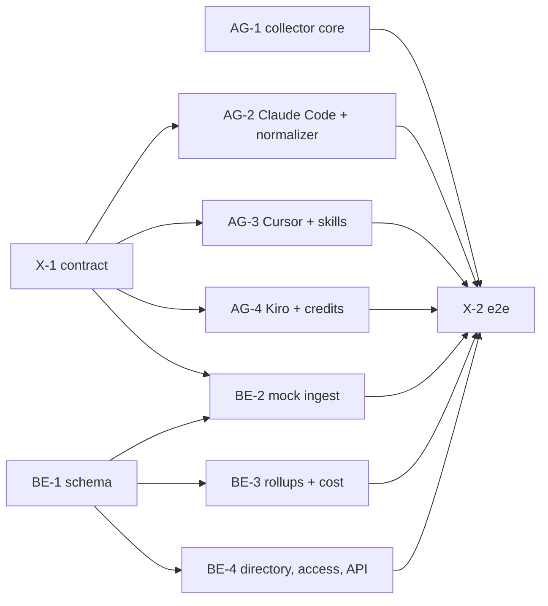

# Tickets

Where each ticket's code goes and what it waits on. The ticket text is in the
project thread. "Done" conditions are copied here so reviewers can check them.

Find the stubs for a ticket with `grep -rn "TODO(BE-2)" packages services e2e db docs`.

## Milestones

| Date       | Milestone                                                  |
| ---------- | ---------------------------------------------------------- |
| Mon Nov 30 | X-1 and BE-1 merged: payload contract and schema           |
| Fri Dec 4  | Every component works against the mocks                    |
| Wed Dec 9  | End to end: collector, mock ingest, Postgres, rollups, API |
| Fri Dec 11 | Demo                                                       |

## Order

AG-1 can start now: the buffer and uploader build against the existing
interfaces and ingest-mock's `/v1/logs`. Only the Jamf credential provider
waits on BE-2's mock `/v1/devices/register`.

## Shared

### X-1 Payload contract

- Code: `packages/contracts` (schemas in `src/events/`, fixtures in `fixtures/v2/`), `docs/contracts/proposed-fields.md`
- Replace every `unmodelledData` in `src/event.ts` with a real schema and add its fixture.
- Done: both teams test against the same fixtures, and the field proposal has been sent to Freshworks.

### X-2 End-to-end test

- Code: `e2e/pipeline.e2e.test.ts`, `packages/testkit/src/traffic.ts`
- Each `it.todo` is one acceptance criterion. Turn them into tests; do not delete them.
- Done: it runs in CI and passes.

## Backend & Data

### BE-1 Postgres schema and migrations

- Code: `db/migrations/`, `services/api/src/jobs/retention.ts`, `docs/data-model.md`
- Done: migrations run from scratch (CI does up, down, up) and the X-1 fixtures load.

### BE-2 Mock ingest service

- Code: `services/ingest-mock` (`src/app.ts`, a `PostgresEventStore` next to `src/store/memory-store.ts`)
- Interface: `EventStore`. Auth is a stub in `authenticate()`.
- Done: replaying the same batch twice stores it once, and the limits are covered by tests.

### BE-3 Rollups and cost module

- Code: `services/api/src/jobs/rollup-daily.ts`, `services/api/src/pricing/`, `db/seeds/` for the default price book
- Interface: `PriceBook`.
- Done: changing a price recomputes cost without touching the raw events.

### BE-4 Directory, access control, query API

- Code: `services/api/src/directory/`, `src/access/`, `src/auth/`, `src/routes/v1.ts`, `packages/testkit/src/org.ts`
- Interfaces: `DirectorySource`, `AccessPolicy`, `resolvePrincipal`.
- Done: a manager cannot see anyone outside their subtree, including after a reorg in the test data.

## Agent & Integration

### AG-1 Collector core

- Code: `packages/collector/src/buffer/` (a `DiskBuffer`), `src/upload/uploader.ts`, `src/auth/`, `src/daemon.ts`
- Interfaces: `EventBuffer` (run `bufferContract` against the new buffer), `Uploader`, `CredentialProvider`.
- Also decide how the collector is packaged for Jamf (ADR 0001 consequences).
- Done: it survives kill -9 mid-flush and the mock ingest shows no duplicates.

### AG-2 Claude Code integration and normalizer

- Code: `packages/collector/src/adapters/claude-code/`, `src/normalize/`, `src/policy/`, `docs/formats/claude-code.md`
- Interface: `HarnessAdapter`.
- Done: one real Claude Code session produces valid events matching the X-1 fixtures.

### AG-3 Cursor integration and skills

- Code: `packages/collector/src/adapters/cursor/` (plus a Cursor Agent adapter), `src/skills/`, `docs/formats/cursor.md`
- Interfaces: `HarnessAdapter`, `SkillScanner`, `CatalogProvider`.
- Done: a skill run in either tool shows up with the right skill and plugin.

### AG-4 Kiro integration and credits

- Code: `packages/collector/src/adapters/kiro/`, `docs/formats/kiro.md`
- First, by Tue Dec 1: the format doc (what Kiro exposes, credits, subagents).
- Done: a Kiro session shows up in the mock ingest with credits and the parent and subagent link.

## Not ticketed yet

- Dashboards (spec 7.6). The query API is built so they can start once BE-3 and BE-4 land.
- Collector packaging and the rollout runbook beyond AG-1's decision.
